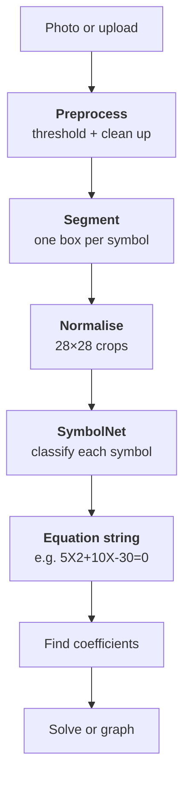

# Photo Equation Solver

A Kivy/KivyMD app that photographs a handwritten linear or quadratic equation, reads it with a custom neural network, then solves it, or graphs it if it starts with `y =`.

## Pipeline



## The neural network

SymbolNet is a small convolutional neural network trained in PyTorch, which reads one symbol at a time. The app runs it in plain numpy, so it doesn't need PyTorch.

| | |
|---|---|
| Architecture | 2 conv layers (16, 32 filters) + 2 fully connected layers |
| Parameters | about 106,000 |
| Classes | 15: `0–9 x y + - =` |
| Training data | 8,617 handwritten symbols, split 70/30 train/test |
| Test accuracy | 97.1% |
| Real photos | 39/39 symbols correct (small sample, so far) |

On the same photos, EasyOCR read 1 of 5 equations correctly. SymbolNet read all 5.

## Running it

```
pip install kivy kivymd opencv-python numpy matplotlib plyer
copy logindetails.example.csv logindetails.csv
python Main.py
```

## Project layout

- `Main.py`, `Main.kv`: the app
- `recogniser.py`, `symbolnet.npz`: reading equations, and the trained weights
- `custom net/`: training and evaluation scripts. The dataset isn't included; it goes in `custom net/Data/dataset/`, one folder per symbol.
